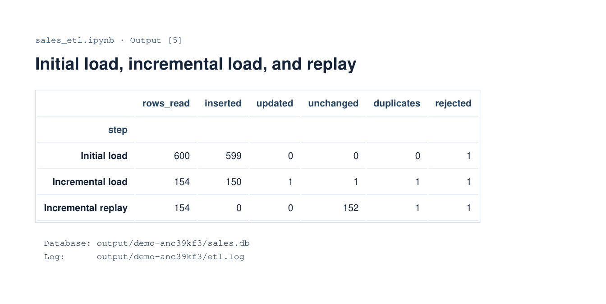
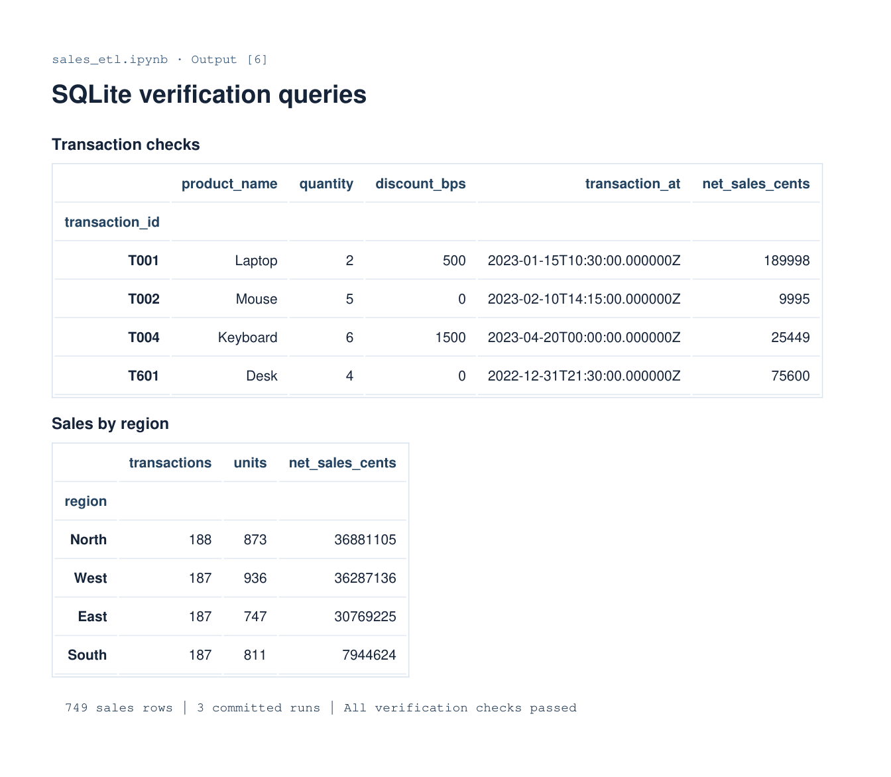

# Task 1 · Python sales JSON ETL

A Jupyter notebook extracts semi-structured sales transactions from JSON, validates and flattens them, and incrementally loads them into SQLite. The notebook also queries the database and verifies the initial load, an incremental batch, and a replay.

## Project files

| File | Purpose |
| --- | --- |
| `sales_etl.ipynb` | Executed notebook with the ETL implementation, SQL queries, and verification checks |
| `sales_data.json` | Initial input with 600 records, including the five sample records from the task |
| `sales_incremental.json` | Follow-up input with 154 records for testing inserts, updates, duplicates, and rejects |
| `schema.sql` | SQLite DDL for `sales`, its indexes, and `etl_runs` |
| `requirements.txt` | Python dependency for the notebook |
| `logs/etl.log` | Log captured from a successful end-to-end demo |
| `screenshots/` | Screenshots of the executed notebook outputs shown below |

The 595 additional initial rows are synthetic variations of the four valid source examples. The line breaks in two date strings from the task prompt were treated as text wrapping when writing valid JSON.

## Run locally

1. Extract the project ZIP. Open **PowerShell** in the extracted `sales-json-etl` folder. Keep the notebook, JSON files, and SQL script together.
2. Use your existing Jupyter environment with **Python 3.11 or newer**. If Jupyter runs in a Conda environment, activate that environment before launching it. The notebook uses Python's built-in `sqlite3` module, so installing a standalone database server or a SQLite GUI is unnecessary.
3. Launch Jupyter from the project folder.

   ```powershell
   jupyter notebook
   ```

4. Open `sales_etl.ipynb` and select your Python 3 kernel. If that kernel needs pandas, add a temporary cell at the top, run the command below once, then restart the kernel.

   ```python
   %pip install -r requirements.txt
   ```

5. Use **Run All**. Read the three run summaries, the SQL results, and the logged rejections. The notebook prints the exact paths to the generated `sales.db` and `etl.log`. Each full demo run creates a fresh `output/demo-*/` folder so you can reproduce the empty-database load without removing earlier results.

To check which Python, SQLite, and pandas versions your kernel is using, run the following in a cell after installing dependencies. The supplied run used Python 3.12, SQLite 3.53, and pandas 2.2.3. The SQL uses SQLite 3.30 or newer.

```python
import sys
import sqlite3
import pandas as pd

print(sys.version.split()[0], sqlite3.sqlite_version, pd.__version__)
```

If the `jupyter` command is unavailable, launch Jupyter using your existing Anaconda or IDE workflow and open the notebook from the project folder. For a fresh environment, install Jupyter Notebook with `python -m pip install notebook` from the Python environment you intend to use.

## ETL rules

| Stage | Behavior |
| --- | --- |
| Extract | Read a UTF-8 JSON array with Python's `json` module and preserve fractional values as `Decimal`. A malformed document or a non-array root fails the batch and writes an error to the log. |
| Flatten and validate | Flatten `product.id`, `product.name`, `product.category`, and `product.price`. Require nonblank IDs, product name, category, and region. Require a positive integer quantity, a nonnegative price with up to two decimal places, and a discount from 0 to 1 with up to four decimal places. Use zero for a missing or null discount. |
| Standardize timestamps | Accept `YYYY/MM/DD HH:MM:SS`, ISO timestamps with optional timezone offsets, `DD-MM-YYYY`, and `YYYY-MM-DD`. Interpret timezone-naive inputs as UTC and date-only values as midnight. Store UTC timestamps with a fixed format. |
| Calculate sales | Store prices and amounts in integer cents and discounts in basis points. Compute gross sales as price × quantity and net sales as gross × (1 − discount), rounded to the nearest cent using half-up rounding. |
| Handle invalid rows and duplicates | Log the source filename, 1-based record index, transaction ID, and rejection reasons. Keep the first valid row for each ID within a batch. Log later valid occurrences and flag whether their normalized values differ. |
| Load | Apply the DDL, stage valid rows, and upsert by `transaction_id`. Commit the sales writes and the audit row together. Use pandas to present the SQL query results. |

## Incremental logic

The notebook reads and validates each incoming file in full. The target changes incrementally. Each valid row gets a SHA-256 hash derived from its normalized business fields. SQLite then compares the staged row with the target row for the same `transaction_id`.

| Comparison | Action |
| --- | --- |
| Transaction ID is absent from `sales` | Insert the row and set `created_at` and `updated_at`. |
| Transaction ID exists and its hash differs | Update the sales attributes and `updated_at`. Keep the original `created_at`. |
| Transaction ID exists and its hash matches | Skip the write. |

The initial and incremental files are processed in arrival order. T601 has a sale timestamp before the initial batch and still loads because no sales-date watermark is used. The source has no version or update timestamp, so applying an older version of a record after a newer version can revert a correction. Load authoritative files in order. Missing IDs in an incoming file do not delete stored rows.

For your own batches, reuse `run_batch()` from the notebook with one persistent database path, such as `output/sales.db`. The demo uses a separate new database each time so the expected row counts are reproducible.

## Verified results

| Run | Read | Inserted | Updated | Unchanged | Duplicates | Rejected |
| --- | ---: | ---: | ---: | ---: | ---: | ---: |
| Initial load | 600 | 599 | 0 | 0 | 0 | 1 |
| Incremental load | 154 | 150 | 1 | 1 | 1 | 1 |
| Incremental replay | 154 | 0 | 0 | 152 | 1 | 1 |

The final database contains **749 sales transactions** and **three committed audit rows**. The replay retains the same sales records and timestamps. T004's quantity changes from four to six. T003 is rejected for its missing customer ID and negative quantity. T751 is rejected for its invalid date.





